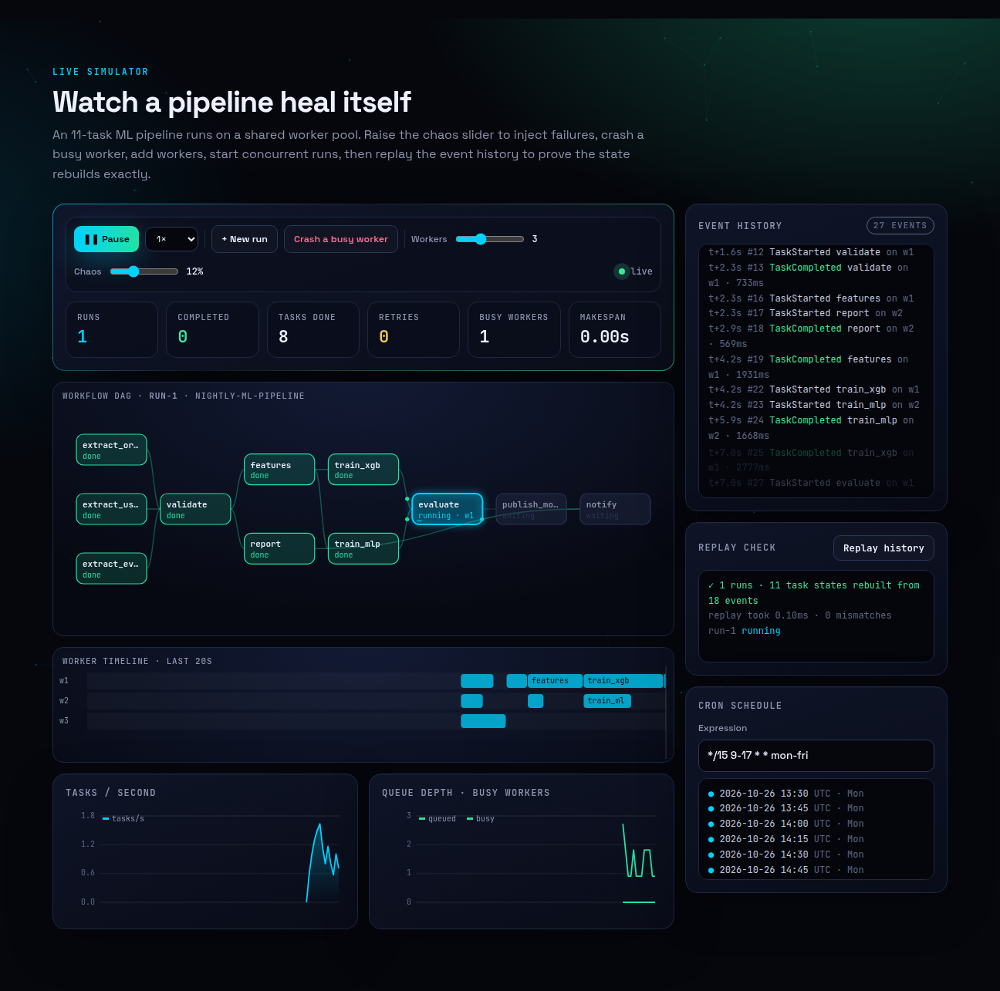
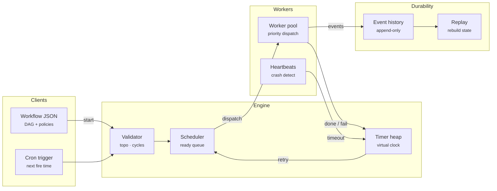
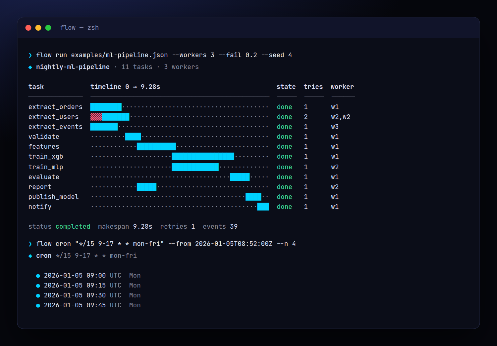
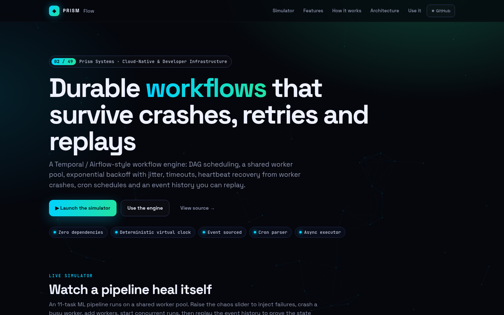
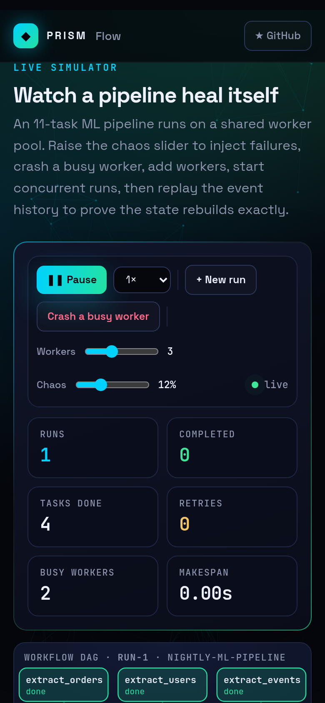

<!-- Prism Systems 02/49 -->
<p align="center">
  
</p>

<p align="center">
  
</p>

<p align="center">
  <a href="https://github.com/krishyaa06/prism-flow/actions/workflows/ci.yml"></a>
  <a href="https://krishyaa06.github.io/prism-flow/"></a>
  
  
  
  <a href="LICENSE"></a>
</p>

<p align="center">
  <a href="https://krishyaa06.github.io/prism-flow/"><b>Live simulator</b></a> ·
  <a href="docs/ARCHITECTURE.md"><b>Architecture</b></a> ·
  <a href="docs/USAGE.md"><b>Docs</b></a> ·
  <a href="#-quick-start"><b>Quick start</b></a>
</p>

<p align="center">
  <a href="https://krishyaa06.github.io/prism-flow/"></a>
</p>


## ⚡ Overview

Every company eventually needs "run these jobs in this order, retry the flaky ones, and don't lose work when a box dies". Prism Flow is a compact, readable implementation of the ideas behind Temporal, Airflow and Step Functions. Workflows are DAGs, workers are a shared pool, failures are retried with jittered exponential backoff, and every state change is an event in an append-only history, so a run can always be reconstructed.

## ✨ Features

| | Feature | Details |
| :-: | --- | --- |
| ⇶ | **DAG engine** | Kahn topological sort, cycle and unknown-dependency detection, depth levels and **critical path** analysis. |
| ▤ | **Shared worker pool** | Tasks from many runs compete for N workers by priority, then FIFO. Concurrency is never exceeded. |
| ↻ | **Retries with jitter** | Exponential backoff with full, equal or no jitter, a cap and per-task `retries`, the way AWS recommends. |
| ⏱ | **Timeouts** | A task that overruns `timeout` is failed and retried like any other error. |
| ♥ | **Crash recovery** | When a worker dies mid-task, the heartbeat timeout fails the attempt and the task is re-queued on a healthy worker. |
| ⟲ | **Event-sourced history** | Every transition is an append-only event. `replay(history)` rebuilds identical state, and the same seed yields the same history. |
| ⏰ | **Cron schedules** | Five-field cron with ranges, steps, names, `@daily`-style macros and Vixie day-of-month/day-of-week semantics. |
| ⚙ | **Real async executor** | `execute(dag, handlers)` runs real async functions with the same retry, timeout and concurrency semantics. |

## 🏗️ Architecture



### How it works

1. **Define** — A workflow is JSON: tasks with `deps`, `retries`, `timeout`, `priority` and optional `backoff`. It is validated as a DAG before it starts.
2. **Schedule** — Root tasks are queued. Whenever a task completes, children whose dependencies are all done get queued.
3. **Dispatch** — Idle workers take the highest-priority queued task across all runs. The engine runs on a virtual clock driven by a timer heap.
4. **Recover** — Failures and timeouts schedule a retry timer using backoff + jitter. Lost workers trigger a heartbeat timeout. Permanent failure skips everything downstream.
5. **Replay** — The history is the source of truth. Replaying it rebuilds every run and task state, which is how durable engines resume after a restart.

More detail in [docs/ARCHITECTURE.md](docs/ARCHITECTURE.md).

## 🚀 Quick Start

**Try it in the browser:** [https://krishyaa06.github.io/prism-flow/](https://krishyaa06.github.io/prism-flow/), no install needed.

```bash
# CLI, no install
npx github:krishyaa06/prism-flow --help

# add the engine to a project
npm install github:krishyaa06/prism-flow
```

### JavaScript API

```js
import { Engine, replay, execute } from "prism-flow";

const wf = { name: "etl", tasks: [
  { id: "extract", duration: 1, retries: 3 },
  { id: "transform", deps: ["extract"], timeout: 5 },
  { id: "load", deps: ["transform"], backoff: { base: 0.5, cap: 10, jitter: "full" } },
]};

// 1) deterministic simulation on a virtual clock
const e = new Engine({ workers: 3, seed: 1, failRate: 0.1 });
e.on((ev) => console.log(ev.t, ev.type, ev.task ?? ""));
e.start(wf); e.drain();
console.log(replay(e.history).get("run-1").status); // "completed"

// 2) run real async handlers with the same semantics
const out = await execute(wf, {
  extract: async () => fetch("https://api.example.com/rows").then((r) => r.json()),
  transform: async ({ results }) => results.extract.map(clean),
  load: async ({ results }) => db.insert(results.transform),
}, { concurrency: 4 });
```

| Export | What it does |
|---|---|
| `new Engine({ workers, seed, heartbeat, failRate })` | Virtual-clock engine |
| `engine.start(wf)` → `runId` | Validate and start a workflow run |
| `engine.advance(dt)` / `engine.drain()` | Advance time / run to completion |
| `engine.crash(workerId)` · `engine.setWorkers(n)` | Chaos and scaling |
| `engine.history` · `engine.on(fn)` · `engine.stats()` | Event log, subscription, counters |
| `replay(history)` | Rebuild run/task state from events |
| `execute(wf, handlers, { concurrency })` | Run real async handlers |
| `validate` · `topo` · `levels` · `criticalPath` | DAG utilities |
| `backoff(attempt, { base, cap, factor, jitter })` | Retry delay |
| `parseCron(expr)` · `nextRuns(expr, from, n)` | Cron |

### CLI

```bash
$ npx github:krishyaa06/prism-flow validate examples/ml-pipeline.json
$ npx github:krishyaa06/prism-flow run examples/ml-pipeline.json --workers 3 --fail 0.2 --history h.json
$ npx github:krishyaa06/prism-flow replay h.json
$ npx github:krishyaa06/prism-flow cron "*/15 9-17 * * mon-fri" --n 5
```

<p align="center"></p>

| Command | Description |
|---|---|
| `flow run <wf.json> [--workers] [--seed] [--fail] [--history f]` | Simulate, print a Gantt chart and stats |
| `flow validate <wf.json>` | Validate the DAG and print the critical path |
| `flow replay <history.json>` | Rebuild state from a saved history |
| `flow cron "<expr>" [--n] [--from]` | Next fire times in UTC |

## 📸 Screenshots

<table>
  <tr>
    <td width="68%"></td>
    <td width="32%"></td>
  </tr>
</table>

## 🧠 Design Decisions

- **Virtual clock + timer heap.** All time flows through a binary heap of timers, so simulations are instant, reproducible and testable. The same seed always produces the same history.
- **History is the source of truth.** The engine's in-memory state is a cache. `replay()` folds the events back into run and task state, which is how Temporal workers recover.
- **Full jitter by default.** `random(0, min(cap, base·2ⁿ))` spreads retries out and avoids thundering herds after an outage.
- **Heartbeats, not trust.** A crashed worker's attempt is only failed after the heartbeat timeout, mirroring at-least-once delivery. Handlers should be idempotent.
- **Failure isolation.** A permanently failed task marks its descendants `skipped`, while independent branches keep running.

## 🏭 Production Notes

To run Prism Flow as a real service:

- Persist `history` to an append-only store (Postgres table, Kafka topic or S3 segments) and call `replay()` on boot.
- Replace the virtual clock with wall time and move the timer heap to a durable timer service (Redis sorted set or DB polling).
- Run workers as separate processes that long-poll the task queue and send heartbeats. `execute()` is the in-process version of that loop.
- Make handlers idempotent with idempotency keys, because recovery is at-least-once.

## 📁 Project Structure

```text
prism-flow/
├── assets/
│   └── logo.svg
├── bin/
│   └── flow.js
├── css/
│   └── app.css
├── docs/
│   ├── ARCHITECTURE.md
│   └── USAGE.md
├── examples/
│   └── ml-pipeline.json
├── js/
│   └── app.js
├── src/
│   ├── lib/
│   │   ├── cli.js
│   │   ├── heap.js
│   │   └── rng.js
│   ├── cron.js
│   ├── dag.js
│   ├── engine.js
│   ├── executor.js
│   ├── index.js
│   └── retry.js
├── test/
│   └── flow.test.js
├── .gitignore
├── LICENSE
├── README.md
├── index.html
└── package.json
```

## 🧪 Tests

```bash
npm test
```

The test suite uses the built-in `node:test` runner, so there is nothing to install. CI runs it on Node 20 and 22.

## 🗺️ Roadmap

- [ ] Child workflows and signals
- [ ] Durable timers backed by Redis
- [ ] Web UI for history search
- [ ] Per-queue rate limits

## 🤝 Contributing

1. Fork the repo and create a branch: `git checkout -b feat/my-idea`
2. Make your change in `src/` and add a test in `test/`
3. Run `npm test`, then open a Pull Request

## 🔷 Part of Prism Systems

**Prism Flow** is system **02 of 49** in **Prism Systems**, a series of open-source reference implementations of large-scale infrastructure by [Prism Protocol](https://dc.gg/prismprotocol). Each one ships a real engine, a CLI and a live simulator, all with zero dependencies.

## 👤 Author

<table>
  <tr>
    <td align="center">
      <a href="https://github.com/krishyaa06"><br><b>Soumya Bhandare</b></a><br>
      <sub>Founder @ Prism Protocol</sub>
    </td>
    <td>
      <a href="https://dc.gg/prismprotocol"></a><br>
      <a href="https://instagram.com/prism_protocol_"></a><br>
      <a href="https://x.com/krishyaa06"></a>
    </td>
  </tr>
</table>

## 📄 License

Released under the [MIT License](LICENSE).

<p align="center">
  <b>If this helped you learn something, consider giving it a ⭐</b><br>
  <sub>"Build. Create. Compete." · Made with ⚡ by Prism Protocol</sub>
</p>


