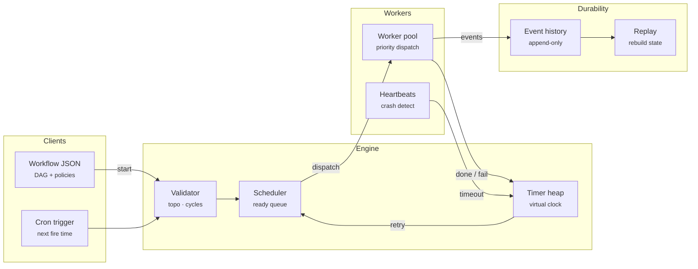

# Prism Flow — Architecture

Every company eventually needs "run these jobs in this order, retry the flaky ones, and don't lose work when a box dies". Prism Flow is a compact, readable implementation of the ideas behind Temporal, Airflow and Step Functions. Workflows are DAGs, workers are a shared pool, failures are retried with jittered exponential backoff, and every state change is an event in an append-only history, so a run can always be reconstructed.

## System diagram

## How it works

1. **Define** — A workflow is JSON: tasks with `deps`, `retries`, `timeout`, `priority` and optional `backoff`. It is validated as a DAG before it starts.
2. **Schedule** — Root tasks are queued. Whenever a task completes, children whose dependencies are all done get queued.
3. **Dispatch** — Idle workers take the highest-priority queued task across all runs. The engine runs on a virtual clock driven by a timer heap.
4. **Recover** — Failures and timeouts schedule a retry timer using backoff + jitter. Lost workers trigger a heartbeat timeout. Permanent failure skips everything downstream.
5. **Replay** — The history is the source of truth. Replaying it rebuilds every run and task state, which is how durable engines resume after a restart.

## Design decisions

- **Virtual clock + timer heap.** All time flows through a binary heap of timers, so simulations are instant, reproducible and testable. The same seed always produces the same history.
- **History is the source of truth.** The engine's in-memory state is a cache. `replay()` folds the events back into run and task state, which is how Temporal workers recover.
- **Full jitter by default.** `random(0, min(cap, base·2ⁿ))` spreads retries out and avoids thundering herds after an outage.
- **Heartbeats, not trust.** A crashed worker's attempt is only failed after the heartbeat timeout, mirroring at-least-once delivery. Handlers should be idempotent.
- **Failure isolation.** A permanently failed task marks its descendants `skipped`, while independent branches keep running.

## Production notes

To run Prism Flow as a real service:

- Persist `history` to an append-only store (Postgres table, Kafka topic or S3 segments) and call `replay()` on boot.
- Replace the virtual clock with wall time and move the timer heap to a durable timer service (Redis sorted set or DB polling).
- Run workers as separate processes that long-poll the task queue and send heartbeats. `execute()` is the in-process version of that loop.
- Make handlers idempotent with idempotency keys, because recovery is at-least-once.
